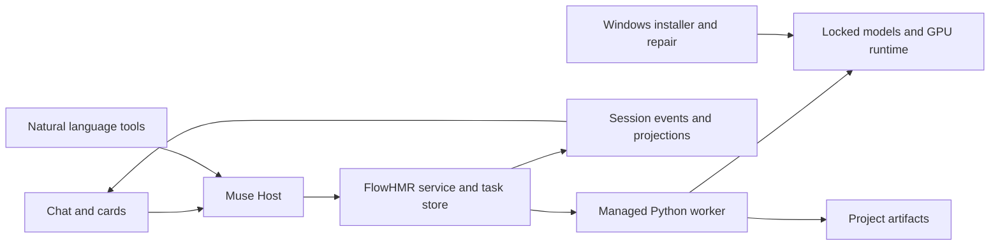

# FlowHMR Windows integration design

English | [中文](2026-11-12-flowhmr-muse-integration-design.zh.md)

## Summary

This design brings the existing FlowHMR-Windows motion-capture workflow into DSH and bundles it with Muse for Windows. Users can start tasks in natural language or select people, adjust motion, preview, and export through chat cards. Complete installation prepares the models and runtime and tests the features during setup; first launch downloads no dependencies. This is an implementation proposal, not acceptance evidence for a plugin, installer, or GPU reconstruction.

The requirements date is 2026-11-12, and the intended use follows the user's explicit noncommercial scope. The feature baseline is [windows-v0.3.1](https://github.com/xiaoerofficial021-collab/FlowHMR-Windows/releases/tag/windows-v0.3.1). Implementation records the exact source, submodule, model, and runtime versions in a lock manifest; later upstream versions require a separate difference review.

## Table of Contents

- [Scope and completion criteria](#scope-and-completion-criteria)
- [Complete feature mapping](#complete-feature-mapping)
- [User flow and chat cards](#user-flow-and-chat-cards)
- [Plugin and runtime architecture](#plugin-and-runtime-architecture)
- [Tools and shared parameters](#tools-and-shared-parameters)
- [Tasks, recovery, and artifacts](#tasks-recovery-and-artifacts)
- [Models and capacity](#models-and-capacity)
- [Ready at installation completion](#ready-at-installation-completion)
- [Licensing and distribution work](#licensing-and-distribution-work)
- [Runtime and compatibility](#runtime-and-compatibility)
- [Implementation stages and acceptance](#implementation-stages-and-acceptance)
- [Risks and release criteria](#risks-and-release-criteria)
- [Dev Note](#dev-note)

## Scope and completion criteria

Complete coverage means the baseline Windows application's video import, person selection, motion reconstruction, preview and correction, character retargeting, exports, model management, runtime management, and history. Layout adapts to Muse while preserving each feature; AMD retains its upstream experimental status. Upstream model training, GRPO, and the Linux Isaac Gym research pipeline are outside this Windows product baseline.

Deliverables include an independently mountable DSH composition bundle, Muse configuration, chat cards, an isolated Python worker, runtime and model manifests, Windows installation and repair, licensing materials, recorded-session snapshots, and device acceptance records. DSH without a GUI supports every domain operation; visual person selection and timeline dragging use the client, with equivalent structured parameters available through tools.

Ready at installation completion means that, on a supported machine, all required assets have applicable authorization and pass verification, and GPU computation, static/moving cameras, hand refinement, preview data, and export checks pass. Subsequent offline launch must support local capture through the GUI. Natural-language calls use Muse's configured conversation model; its network requirements are documented separately from local capture, and this design does not include an offline large language model. Initial model loading can still incur cold-start latency.

## Complete feature mapping

The baseline [README](https://github.com/xiaoerofficial021-collab/FlowHMR-Windows/blob/windows-v0.3.1/README.md), [export guide](https://github.com/xiaoerofficial021-collab/FlowHMR-Windows/blob/windows-v0.3.1/docs/retarget-export.md), [Web service](https://github.com/xiaoerofficial021-collab/FlowHMR-Windows/blob/windows-v0.3.1/tools/web/server.py), and [frontend modules](https://github.com/xiaoerofficial021-collab/FlowHMR-Windows/tree/windows-v0.3.1/tools/web/static/js) define the features. This table specifies implementation and acceptance scope; it does not claim these capabilities already exist in Muse.

| Feature | Muse entry and behavior | Completion criterion |
|---|---|---|
| Video import | Drop an attachment, choose a file, or reference it in chat; preserve baseline formats | Validate actual media streams, retain the source digest, and explain corruption or limits |
| Frame range | Select a timeline interval or give times/frame numbers in chat | Define endpoint semantics and retain original-timestamp to processing-frame mapping |
| Detection and tracking | Person thumbnails, numbers, tracks, and appearance intervals | Accept single-person, multiple-person, occlusion, and crossing cases separately |
| Person selection | Card multiselect or an unambiguous reference to detected people in chat | Show choices for ambiguity; waiting never changes the selected people automatically |
| Static/moving camera | Card mode selection with automatic and manual sampling | Share camera results, record actual settings, and preserve explicit user values |
| Motion generation | Queue, stage progress, cancellation, and rerun | Independent result state for each task and person |
| Hand refinement | HaMeR switch and baseline sampling options | Models and MANO ready; failure cannot silently produce a result labeled refined |
| Motion correction | Baseline filters, foot contact, ground height, and related settings | Persist settings, compare revisions, and return to earlier revisions |
| Synchronized preview | Source/3D side by side, scrubbing, looping, and original audio | One time base with synchronized play, pause, and seek |
| 3D display | Skin/skeleton selection and baseline view controls | Lightweight inline preview and an expandable full viewer |
| Multiple-person scene | Synchronized display, combined scene, and combined export | Preserve relative placement and entrance times instead of resetting each person |
| Body variants | Neutral and baseline male/female variants | Install corresponding models in the complete configuration and test each load |
| Custom characters | Import PMX and skinned Mixamo/MetaHuman FBX | Skeleton compatibility feedback, texture/dependency checks, and a reusable library |
| Character adjustment | Per-person binding, bone/pose adjustments, and remembered settings | Bind settings to character, person, and revision; preserve them after reopening |
| PMX motion | Native IK/FK and foot IK for compatible characters | Read back previews and character-specific VMD exports |
| FBX export | FlowHMR/Mixamo single/group; MetaHuman single person, target body FBX template, skeleton animation | Preserve format-specific person limits, target skeleton, coordinates, timing, and applicable skin options |
| Reference pose | None/T Pose/A Pose where the format supports it | Write supported FBX poses at frame −1 without shifting motion |
| NPZ/VMD export | Raw motion; 30 FPS VMD, one file per person in a ZIP for groups | Preserve relative placement/entrance times; validate character mapping and compatible PMX foot/toe IK |
| History and cache | Thumbnail history, reopening, retry, deletion, and cache cleanup | Survive restarts; cache cleanup preserves published artifacts |
| Model management | Status, sources, verification, repair, archive/folder import | Check hands and every target body variant, beyond core models |
| Runtime management | GPU status, compatible runtime download/selection/repair | Switch after stopping safely; enable only after verification and retain old versions on failure |
| Languages and desktop actions | Baseline seven languages, file picking, and opening output folders | Use Muse locales and controlled host interfaces |

Preserving relative placement requires fidelity in output and display; it does not guarantee exact real-world scale, identity after occlusion, or every object interaction from monocular video. Actual footage determines motion-quality acceptance; successful file generation alone is insufficient.

## User flow and chat cards

A typical instruction is: “Extract the two people in the middle from seconds 3 to 12, refine fingers, and export Mixamo FBX.” Muse parses explicit settings, imports the video, and detects people; ambiguity opens a selection card. After Start or an explicit chat instruction, the Host persists the complete execution settings before queueing. Card actions and natural-language calls use the same domain service.

| Card | Content | Main actions |
|---|---|---|
| Capture setup | Video summary, range, person thumbnails, camera, hands, body, destination | Select people, change range, expand advanced settings, start |
| Capture progress | Queue position, stage, per-person state, elapsed time, recent status | Cancel, inspect available results; show remaining time only when defensible |
| Motion result | Synchronized video/3D, revision, people/characters, quality notices | Correct, compare revisions, bind characters, expand viewer, export |
| Characters and export | Format, skeleton, skin, reference pose, single/group selection | Import character, adjust bones, create files, open folder |
| Environment | Models, GPU, runtime, license, and test summary | Details, verify, repair, installer model import |
| History | Thumbnail, video, settings summary, state, time, artifacts | Open, continue processing, retry, manage cache, delete |

Cards collapse to video, people, range, status, and the main action. The full viewer expands in chat and can use an existing overlay on narrow windows. Reuse Muse cards, progress, menus, Toast, and theme variables; check both themes, keyboard access, focus, scrolling, viewport edges, and narrow layouts. Product text uses typed locale dictionaries; technical logs stay in details.

Muse currently includes Chinese and English. Full FlowHMR coverage adds language definitions and complete feature dictionaries for Traditional Chinese, Japanese, Korean, Russian, and French. Test shared buttons, overlays, and validation in all seven languages. Untranslated Muse-wide UI explicitly uses existing language fallback rather than claiming the entire application has seven translations.

Cards read durable state by stable task ID and revision. Historical cards show submitted settings alongside current task state; actions carry an expected revision and refresh on conflicts instead of overwriting newer settings. Progress subscriptions stop for invisible cards and resume when reopened. Avoid adding a chat message for every frame or progress increment.

Detection results and person selection are persistent user decisions. Replace upstream's selection-timeout fallback with continued waiting or explicit interruption; it must not silently generate a different person. Partial failures are reported per person instead of presenting incomplete results as complete.

## Plugin and runtime architecture

Follow the [DSH architecture](../../architecture.md) through Cordis services, tools, session projections, and client extensions without modifying the agent loop. Reuse locked upstream Python for inference and numerical processing; migrate selection, viewer, character, and export modules into Muse, replacing page globals and desktop bridge dependencies. Native Muse cards are the release target; the original page is a development reference.

The following units and responsibilities are proposed. Implementation confirms package names against repository rules and splits further only when responsibilities need independent evolution.

| Proposed unit | Responsibility and dependencies |
|---|---|
| `packages/perception/flowhmr` | Cordis Service Definition, request/result/config types, shared domain operations |
| `packages/perception/flowhmr-local` | Service Provider: worker, task store, resource checks, cache, exports; managed subprocess/fs dependencies |
| `packages/perception/tool-flowhmr` | Consumer: model tools, pure presenters, permissions, session result recording |
| `packages/client/ui-flowhmr` | Cards, synchronized viewer, character/export forms, history, locales, controlled client actions |
| `packages/bundle/flowhmr` | Composition bundle with headless tools and optional client configuration for independent DSH installation |
| Muse configuration and installer scripts | Desktop dependencies, applicable presets, settings entry, isolated resources, Windows setup integration |

The service covers preparation, detection, selection, reconstruction, correction, preview, characters, exports, history, and environment management. Clients consume serialized views without importing Host Node/Python implementations. Configuration includes resource roots, GPU/runtime, concurrency, timeouts, input limits, cache quotas, and inference settings. The owning resolver creates complete execution settings; run methods never silently replace explicit choices.

Prefer a private stdio worker protocol, using upstream HTTP capabilities as a migration reference. If its service is reused, bind explicitly to loopback, authenticate with a per-launch credential, and proxy through the Host instead of exposing its address to clients. Every action checks session/project ownership, including models, character files, previews, and downloads. Workers receive only required environment variables and never inherit Muse model keys.

Use controlled file references, validate media and character files, archive paths, and output destinations, and reject traversal and excessive resource use. Media commands use argv rather than shell strings; termination waits for child exit. Registrations, subscriptions, and background loops use `ctx.effect()`/`ctx.on()`; plugin shutdown releases GPU resources while project artifacts remain independent.

## Tools and shared parameters

Four domain tools avoid exposing one model schema for every upstream route. Names and actions below are proposals, not available tools. Every GUI domain operation has a structured equivalent; runtime repair and similar actions disclose their effects without unnecessary confirmations for routine local work.

| Tool | Proposed operations |
|---|---|
| `flowhmr_environment` | Status, diagnostics, model inventory/verification/import/repair, runtime inventory/selection/repair, license details |
| `flowhmr_motion` | Prepare/detect, save settings/select people, start, query/history, cancel, retry, correct motion, compare revisions, cleanup |
| `flowhmr_character` | Import/list/remove, bind people, adjust bones/poses, configure IK/FK |
| `flowhmr_export` | Preview references, format capabilities, single/group export, artifact inventory, open output |

Before submission, fix the video digest, original range/frame mapping, person/track IDs, body, camera/sampling, hand settings, correction, seed, steps, model/runtime versions, target character/skeleton, export settings, project, and destination. Cross-package task, person, character, and artifact IDs are branded. Writes carry a request ID and expected revision; duplicate clicks or tool retries return the same receipt.

Explicit chat selections or the latest saved card values take precedence; conflicts become explicit revisions. Saving successfully precedes submission instead of following task launch asynchronously. Public defaults resolve only where the user made no choice. Automatic memory strategies never overwrite explicit sampling or quality settings; unsupported requests explain the cause and offer alternatives.

Cancel stops computation; retry creates a related attempt; correction creates a motion revision; export binds exact motion and character revisions. Corrections/exports that can reuse features do not automatically repeat inference. Completed tasks return structured summaries, actual settings, per-person states, and stable artifact references, excluding full skeleton arrays, per-frame meshes, and local credentials from model context.

## Tasks, recovery, and artifacts

Existing [background jobs](../../../packages/jobs/jobs/README.md) and [jobs UI](../../../packages/client/ui-jobs/README.md) display tasks, but local runtime state disappears when the Host exits. FlowHMR needs durable task records; current background jobs must not be described as already supporting crash-resumable computation.

| State | Behavior |
|---|---|
| `draft / detecting / waiting_selection` | Save input and detections, awaiting explicit people and settings |
| `queued / running` | Queue resources; record actual stage, heartbeat, and worker identity |
| `cancel_requested / cancelled` | Settle after computation stops; preserve usable results |
| `succeeded / partial / failed` | Settle per person and artifact completeness; actionable errors and retry |
| `interrupted` | Unsettled after crash/restart; reconcile before continuing or rerunning |

As the single writer, the Host atomically replaces versioned task receipts containing operation IDs, revisions, input/model/parameter digests, stage cache, motion revisions, artifacts, errors, and times. Locks and revision checks prevent two Muse instances from duplicating the same task. Publish stage files only after validation; changed inputs or models invalidate incompatible caches.

At startup, reconcile previous workers and artifacts before marking unfinished attempts interrupted. Resume later stages only from real, complete caches matching the recorded versions; do not promise continuation inside an interrupted CUDA operation. Retain attempt relationships and avoid automatically repeating expensive work. Runtime changes wait for quiescence; running tasks retain their locked versions.

Card actions and tool calls create replayable records. Reuse existing tool/results and task records; declare session types and projections for necessary new business events. Custom events are log-only by default, not automatically model-visible. Out-of-turn selections, corrections, and completion notices enter the owning Session's next admissible request through supported input or message projections, recording operation IDs, origin, and already-executed results to prevent duplicate execution. Recoverable pending-publication records coordinate task storage with session publication so a submitted card cannot lose its execution record. Persistence types follow existing acknowledgements, migration rules, and updates to both SDKs.

Publish artifacts in stable user-project directories containing original input references/digests, execution settings, per-person NPZ, motion revisions, character settings, exports, previews, and quality records. Validate staged files before atomic publication; record units, coordinates, frame rate, entrance times, and reference-pose conventions. [present](../../../packages/deliverables/tool-present/README.md) references files without copying or archiving them, so save artifacts first. History deletion, cache cleanup, and artifact deletion are distinct actions; artifact deletion identifies affected files explicitly.

## Models and capacity

Figures derive from file sizes in baseline [model_sources.py](https://github.com/xiaoerofficial021-collab/FlowHMR-Windows/blob/windows-v0.3.1/flowhmr/model_sources.py), without downloading weights; GB is decimal. Complete configuration includes moving-camera and hand-refinement models rather than omitting dependencies labeled optional upstream.

| Resource | Known size | Complete configuration |
|---|---|---|
| FlowHMR latest and config | 1.842 GB | Required; baseline recommended model |
| YOLOX | 0.434 GB | Required for detection |
| SAM 3D Body + MHR + config | 2.805 GB | Required for body features and related assets |
| VGGT-Omega | 4.577 GB | Required for moving cameras |
| Joint regressor | 0.000662 GB | Required |
| Public core subtotal | 9.659 GB | Excludes restricted body models and runtime |
| HaMeR weights, config, parameters, source ZIP | 2.692 GB | Required for hand refinement |
| Public resource total | 12.351 GB | 12,350,525,357 bytes, including small configs and source ZIP |
| Neutral/male/female SMPL-H and MANO hands | Measure authorized files | Required for all body variants and hands; validate against locked code |
| Python, PyTorch/TorchVision, runtime libraries | Additional | Upstream CUDA 12.8 torch wheels download about 3.47 GB; not installed size |

The baseline Windows one-click groups exclude `flowhmr_base`; complete coverage does not require every historical checkpoint. Explicit support for additional models requires separate capacity and acceptance updates. HaMeR's approximately 6.04 GB fallback archive is an alternative to the approximately 2.69 GB direct weights, not an additional required download; choose an authorized, verifiable distribution route.

Measure download size, compressed distribution, installed usage, and installation peak separately. Required disk combines expanded resources, download/extraction staging, retained upgrade versions, and headroom, with project/cache usage separate. The installer calculates from its manifest rather than asserting an unmeasured total. Separate version/digest-based model storage allows reuse across Muse upgrades.

## Ready at installation completion

Use a Muse installer with locked resource packages and provisioning during setup. Resources may be split or downloaded by the installer with clear size and progress; built-in delivery does not require one executable containing every large file. Offline delivery uses the same manifest, resource packages, and lawfully available model files, with identical readiness criteria.

Installation follows this sequence. Missing dependencies or failed checks leave capture marked incomplete; normal Muse installation may remain, but capture is not presented as ready.

1. Check Windows/architecture, GPU/driver, available RAM/VRAM, disk, path permissions, and resource totals; display applicable terms and required user actions.
2. Obtain distributable resources and acquire, verify, and import restricted assets during installation using the next section's route. Personal credentials never enter distribution packages or other users' installations.
3. Install isolated Python, GPU-compatible PyTorch/TorchVision and dependencies, FFmpeg, exporters, and prebuilt correction modules outside ASAR. Do not modify system Python or depend on a global CUDA toolkit.
4. Verify every file's locked version, size, and SHA-256 and check source/license manifests; resume downloads, replace corruption, and extract safely. Freeze all runtime wheels and transitive dependencies beforehand.
5. Select a compatible runtime and perform real GPU operations; load all required models and body variants and check local asset resolution without downloading missing files during tests.
6. Use distributable short samples to exercise static cameras, moving cameras, multiple people, and hands, then corrections, preview data, and FBX/VMD/NPZ checks. Sample checks do not replace full device acceptance.
7. Write an installation receipt covering software, resources, driver/GPU, and test results; activate ready configuration only after complete success. Recheck lightly after restart and repeat necessary checks after driver/model changes.
8. Verify offline startup and GUI capture, retain the report, and remove safely disposable staging. Prepare dependencies again only for requested repair, upgrades, or additional capabilities.

Downloads and installation use transactional directories and atomic activation, retaining the previous valid version on failure. Support interrupted setup, insufficient disk, proxies/mirrors, offline import, and repair. Install one device-compatible CUDA runtime by default, not every version; later selections use the same validation. Fully offline media must include runtimes for its target GPUs.

## Licensing and distribution work

Noncommercial intent defines this design's purpose, while each asset retains specific use, attribution, acceptance, and redistribution requirements. Public download availability does not grant unconditional packaging rights, and mirrors do not alter licenses. Record each file's license version, source, digest, attribution, use/distribution basis, and user acceptance. The following items require completion and do not claim authorization has been obtained.

| Component | Observed conditions | Work before distribution |
|---|---|---|
| FlowHMR/Windows source | Apache-2.0 | Retain licenses, credits, modification notices, and applicable NOTICE |
| FlowHMR weights | Limited noncommercial education/research/nonprofit purposes; conditional use/modification/distribution allowed | Include full license, origin, and credits; confirm actual purpose qualifies |
| SMPL-H / MANO | MANO webpage grants personal, nontransferable rights, restricts third-party distribution, and prohibits commercial products, services, and artifacts | Check archive terms; obtain permission covering recipients/preinstallation or have recipients acquire/import under their licenses during setup; self-download does not expand permitted uses |
| VGGT-Omega | FAIR Noncommercial Research License limits materials and outputs/results to noncommercial research uses | Confirm checkpoint terms and purpose, include the agreement and research-publication acknowledgement; free/noncommercial alone does not establish eligibility |
| SAM 3D Body / MHR / DINOv3 | SAM and specific model/bundled assets have requirements; official access requests exist | Check code, checkpoint, MHR, and DINOv3 versions separately, retain terms, and resolve access/acceptance |
| HaMeR / YOLOX / regressor | Code, weights, and parameters can have different publishers | Check each downloaded asset's license; handle HaMeR's MANO dependency separately |
| Autodesk FBX runtime | Upstream uses `fbxsdkpy`; SDK redistribution/repackaging has separate requirements | Check selected wheel/SDK terms and obtain required permission; replacement exporters require equivalent format acceptance |
| FFmpeg | Baseline Windows bundle uses a GPLv3 build | Retain exact build, license, corresponding source, and distribution materials, beyond a project link |
| Python/PyTorch/Microsoft runtimes/frontend dependencies | Individual terms; Microsoft redistribution conditions | Produce complete third-party inventory and required texts/agreements; acquire drivers through supplier channels |
| User characters and test footage | Models, textures, and video have their respective owners | Use authorized distribution samples; keep user characters out of public installers |

Support two installation routes explicitly: preload restricted files with distribution permission covering recipients, or guide each recipient through official login, applicable acceptance, and file import during setup. The latter still finishes preparation during installation but requires user interaction. Without applicable permission, fully unattended preinstallation of restricted assets cannot be promised. A static-only or handless reduced configuration does not satisfy complete delivery.

Sources include the [FlowHMR weights license](https://huggingface.co/fafsaf1/flowhmr-0.46B/blob/main/LICENSE), [MANO terms](https://mano.is.tue.mpg.de/license.html), [VGGT-Omega terms](https://github.com/facebookresearch/vggt-omega/blob/main/LICENSE), [SAM terms](https://github.com/facebookresearch/sam-3d-body/blob/main/LICENSE), [DINOv3 terms](https://github.com/facebookresearch/dinov3/blob/main/LICENSE.md), [Windows notices](https://github.com/xiaoerofficial021-collab/FlowHMR-Windows/blob/windows-v0.3.1/THIRD_PARTY_NOTICES.md), [FBX SDK documentation](https://help.autodesk.com/cloudhelp/2020/ENU/FBX-Developer-Help/files/welcome_to_the_fbx_sdk/FBX_Developer_Help_welcome_to_the_fbx_sdk_what_is_autodesk_fbx_technology_html.html), and [FFmpeg distribution guidance](https://www.ffmpeg.org/legal.html). External licensing correspondence and possible fees are outside authorization to prepare this design.

## Runtime and compatibility

Runtime choices follow the baseline [Windows guide](https://github.com/xiaoerofficial021-collab/FlowHMR-Windows/blob/windows-v0.3.1/docs/windows.md) and [runtime implementation](https://github.com/xiaoerofficial021-collab/FlowHMR-Windows/blob/windows-v0.3.1/flowhmr/runtime_environments.py). Muse's existing Office/media Python does not establish GPU readiness; FlowHMR remains isolated from other model runtimes.

| Item | Design and required verification |
|---|---|
| OS | Windows 10/11 x64; test clean setup, standard users, non-ASCII/spaced/long paths, read-only install directories |
| NVIDIA | Primary acceptance path; select GPU/driver-compatible runtime; baseline supports CUDA 12.6/12.8/12.9 and recommends 12.8 for RTX 50 |
| AMD | Retain experimental Windows 11/gfx1201 entry; upstream full capture awaits device verification, reported separately |
| CPU / macOS | No complete inference acceptance evidence; do not promise local full functionality or silently use paid remote services |
| VRAM and RAM | Determine minimum/recommended configurations on devices across cameras, hands, people, and clip lengths; do not infer consumer minima from A100 |
| Dependencies | Freeze Python 3.10 x64, GPU wheels, and transitives; prebuild correction modules needing MSVC so end users need no compiler |
| Media/export | Supply FFmpeg, FBX dependencies, and viewer assets locally; WebView2 applies only if retaining the upstream shell, not the native Muse design |
| Concurrency/resources | Initially one reconstruction per GPU; resource-aware queueing, limited preview/export concurrency, configurable timeouts and input limits |

The official [A100 report](https://github.com/flowhmr/flowhmr/blob/main/docs/performance.md) records approximately 27.22 seconds/10.82 GiB for optimized 300-frame static capture and 53.97 seconds/31.76 GiB for per-frame moving-camera estimation, excluding loading and warmup. These demonstrate resource variation only; Windows has its own staged resource strategy, and Muse performance promises require device measurements with the locked version.

Measure installation peak, cold/warm start, stage times, peak VRAM/RAM, output sizes, cancellation latency, and long sequences separately. Explain model-length, media-size, and resource limits before execution. Any segmentation needs checks for motion continuity, identity, and group timing rather than assuming concatenated segments are equivalent.

## Implementation stages and acceptance

Stages determine implementation order, while the complete feature table remains delivery scope. Licensing work may run alongside development; unresolved assets do not enter public distributions. Person-days below estimate engineering effort, not approved spending or hardware purchases.

| Stage | Deliverable | Planning estimate | Evidence for progression |
|---|---|---|---|
| A: Baseline/resources | Feature checklist, code/model/runtime locks, license matrix, distributable samples | 2–4 person-days | All versions/assets identified; unresolved permissions have owners and routes |
| B: Controlled engine | Isolated worker/protocol, detect/reconstruct/correct/export, first device run | 5–8 person-days | All inference branches/formats run; reproducible errors, cancellation, resource cleanup |
| C: DSH/durable tasks | Services, tools, idempotency, recovery, project artifacts, sessions/projections | 4–6 person-days | Natural-language/structured calls, restart, duplicate-submission acceptance |
| D: Cards/interactions | Selection, sync viewer, character library, IK/FK, export, history/environment cards | 8–12 person-days | Per-feature GUI comparison and product review |
| E: Installer/repair | Packages, online/offline provisioning, checks, upgrade/rollback, notices | 4–7 person-days | Clean-machine setup without developer tools and offline first use |
| F: Device/motion acceptance | Device matrix, Blender/target readback, performance/regression records | 5–8 person-days | Complete matrix passes; defects resolved or explicitly block complete release |

Total estimated engineering effort is 28–45 person-days, partly parallelizable. Calendar time also depends on GPUs, licensing responses, and upstream compatibility. This excludes training, replacing core models, or independently rewriting numerical algorithms; if required, those changes need revised estimates.

| Acceptance layer | Required results |
|---|---|
| Domain/process | Request parsing, selection ambiguity, idempotency, saved parameters, cache invalidation, termination, sensitive-environment isolation |
| Session snapshots | Language-to-settings, group selection, progress/partial failure, correction/export, cancel/recovery; keyless coverage of visible behavior |
| Real natural language | End-to-end configured-model checks for actual Chinese instructions, selection ambiguity, and card interoperability; replay does not replace real parsing, and fees need applicable authorization |
| Card GUI | Chat/button equivalence, refresh/reconnect/stale cards, themes, seven languages, keyboard, narrow windows, full viewer |
| Models/devices | Target NVIDIA generations; cameras, HaMeR, every body variant, multiple people, resource exhaustion; separate AMD experimental results |
| Motion/export | Source comparison for sliding, ground penetration, timing, fingers, identity changes; Blender FBX import, target-character readback, VMD IK |
| Installation/release | Nondevelopment environment, missing permissions, offline/proxy, resume, corruption, disk exhaustion, upgrade/rollback, signing, complete resource inventory |
| History/data | Host/worker crashes, reopening, attempts, moved-project feedback, cache cleanup, artifacts retained after uninstall |

Follow the [testing policy](../../testing.md), recorded-session rules, client checks, and [Desktop packaging requirements](../../../apps/desktop/README.md). Record source tests, successful packaging, GPU execution, target-application readback, and motion-quality review separately; none substitutes for another.

## Risks and release criteria

Open items include restricted body/hand distribution, VGGT purpose eligibility, FBX runtime redistribution, consumer-GPU resources, viewer/retargeting coupling when migrating into Muse, Windows signing, and reliable large-package downloads. Each requires explicit work without preventing this design's preparation or review.

Complete release requires no missing features, a distribution basis for every asset, a workable restricted-asset installation route, reliable checks on supported devices, offline capture after full installation, readback for every export, traceable shared parameters for chat/cards, and retained artifacts after failure/restart. Explain incompatible licenses/devices; missing-model, static-only, or handless configurations cannot appear fully ready.

## Dev Note

This work inspected local DSH/Muse and upstream source, documentation, and asset metadata only, without downloading models, installing GPU runtimes, or executing inference. Package names, actions, states, and installer receipts are proposed; implementation fixes protocol fields and hardware thresholds after verification. The local [BGM resource script](../../../apps/desktop/scripts/prepare-bgm-runtime.ts), [video inspection implementation](../../../packages/perception/tool-video-inspect/src/index.ts), and [tool-card registration](../../../packages/client/ui-tool/README.md) are references, not evidence of FlowHMR integration.
