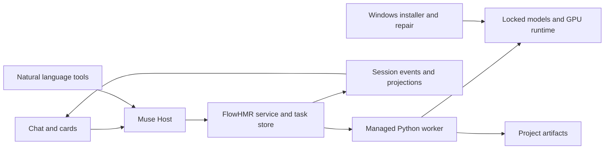

# FlowHMR Windows 完整集成方案

[English](2026-11-12-flowhmr-muse-integration-design.md) | 中文

## 概述

本方案将 FlowHMR-Windows 的现有动捕工作流完整接入 DSH，并内置于 Muse Windows 桌面版。用户可以用自然语言发起任务，也可以在聊天卡片中选人、调整动作、预览和导出。完整安装必须在安装期完成模型、运行时和功能自检，首次打开不再下载依赖。本方案是待实施设计，不代表插件、安装包或 GPU 动捕已经验收。

需求日期为 2026-11-12；使用目的按用户明确的非商业用途制定。功能基线为 [windows-v0.3.1](https://github.com/xiaoerofficial021-collab/FlowHMR-Windows/releases/tag/windows-v0.3.1)。实现时将对应源码、子模块、模型和运行时的确切版本写入锁定清单；后续上游版本通过单独差异审查更新。

## 目录

- [交付范围与完成标准](#scope-and-completion-criteria)
- [完整功能映射](#complete-feature-mapping)
- [用户流程与聊天卡片](#user-flow-and-chat-cards)
- [插件与运行架构](#plugin-and-runtime-architecture)
- [工具与统一参数](#tools-and-shared-parameters)
- [任务、恢复与成果](#tasks-recovery-and-artifacts)
- [模型与容量](#models-and-capacity)
- [安装完成即用](#ready-at-installation-completion)
- [授权与分发待办](#licensing-and-distribution-work)
- [运行环境与兼容](#runtime-and-compatibility)
- [实现阶段与验收](#implementation-stages-and-acceptance)
- [风险与发布条件](#risks-and-release-criteria)
- [开发备注](#dev-note)

## 交付范围与完成标准

“完整”指基线 Windows 版的视频导入、人物选择、动作重建、预览修正、角色重定向、导出、模型管理、运行时管理和历史管理。界面布局适配 Muse，但功能逐项保留；AMD 继续保留原版实验标记。上游的模型训练、GRPO 和 Linux Isaac Gym 研究流程不属于这一 Windows 产品功能基线。

交付包括可独立挂载的 DSH 插件组合包、Muse 内置配置、聊天卡片、隔离 Python worker、运行时与模型资源清单、Windows 安装和修复流程、许可材料、录制会话快照及实机验收记录。DSH 无界面模式可以调用全部领域操作；可视选人和拖动时间轴通过客户端完成，等价的结构化参数也能由工具提交。

“安装完成即用”的判据是：在支持的机器上，所有功能所需资产已获得适用授权并通过校验，GPU 运算、固定/运动相机、手指精修、预览数据及各类导出自检通过；随后断网启动仍能通过界面完成本地动捕。自然语言调用使用 Muse 已配置的对话模型，其联网需求与动捕本地运行分别说明；本方案不声称附带离线大语言模型。第一次加载模型仍可能有冷启动等待。

## 完整功能映射

功能依据基线 [README](https://github.com/xiaoerofficial021-collab/FlowHMR-Windows/blob/windows-v0.3.1/README.md)、[导出说明](https://github.com/xiaoerofficial021-collab/FlowHMR-Windows/blob/windows-v0.3.1/docs/retarget-export.md)、[Web 服务](https://github.com/xiaoerofficial021-collab/FlowHMR-Windows/blob/windows-v0.3.1/tools/web/server.py)和[前端模块](https://github.com/xiaoerofficial021-collab/FlowHMR-Windows/tree/windows-v0.3.1/tools/web/static/js)。下表定义实施与验收范围，不表示 Muse 当前已有这些能力。

| 功能 | Muse 入口及行为 | 完成判据 |
|---|---|---|
| 视频导入 | 拖入附件、文件选择或对话引用；沿用基线支持格式 | 校验真实媒体流，保存原文件摘要，损坏和超限有明确反馈 |
| 帧范围 | 卡片时间轴选择区间；对话输入时间或帧号 | 明确端点规则，保存原始时间戳到处理帧的映射 |
| 检测与跟踪 | 人物缩略图、编号、轨迹和出现区间 | 单人、多人、遮挡和交叉素材分别验收 |
| 选取人物 | 卡片多选；对话指定已检测编号或明确人物 | 歧义时显示选择；等待不自动改选人物 |
| 固定/运动相机 | 卡片切换；支持自动与手动采样设置 | 共用相机结果，实际参数可追溯，保留用户指定值 |
| 动作生成 | 排队、分阶段进度、取消和重新运行 | 每个任务及每个人物有独立结果状态 |
| 手指精修 | HaMeR 开关及基线采样选项 | 模型和 MANO 已就绪；失败不能静默交付为已精修 |
| 动作修正 | 基线滤波、脚接触、地面高度和相关选项 | 参数持久化，新版本可比较并可回到旧版本 |
| 同步预览 | 原视频与 3D 并排、拖动、循环和原声 | 同一时间基准；播放、暂停、跳转保持同步 |
| 3D 显示 | 蒙皮/骨架切换和基线视角控制 | 内联轻预览，展开后可操作完整查看器 |
| 多人场景 | 同步显示、合并场景及合并导出 | 保留相对站位和入场时刻，不独立归零每个人物 |
| 体型 | 中性及基线支持的男性/女性体型 | 完整配置预装对应模型；逐项加载验证 |
| 自定义角色 | 导入 PMX、带蒙皮 Mixamo/MetaHuman FBX | 骨架兼容提示、纹理和依赖校验、角色库可复用 |
| 角色调整 | 每人绑定角色、骨骼/姿态调整及记忆 | 参数按角色、人物和版本绑定，重开后一致 |
| PMX 动作 | 兼容角色的原生 IK/FK 和脚部 IK | 预览及按角色导出的 VMD 实际回读检查 |
| FBX 导出 | FlowHMR/Mixamo 单人或合并；MetaHuman 单人、目标身体 FBX 模板及骨骼动画 | 按格式保留单/多人限制、目标骨架、坐标、时间和适用蒙皮选项 |
| 参考姿势 | 不添加/T Pose/A Pose，按格式适用范围展示 | 支持的 FBX 在第 −1 帧写入姿势，动作帧不移位 |
| NPZ/VMD 导出 | 原始动作数据；30 FPS VMD，多人逐人输出打 ZIP | 保留相对站位、入场时刻，校验角色映射及兼容 PMX 的脚/脚尖 IK |
| 历史与缓存 | 缩略图历史、重新打开、重试、删除及缓存清理 | 历史跨重启保留；清理缓存不删除正式成果 |
| 模型管理 | 状态、来源、校验、修复、压缩包/文件夹导入 | 包含手指和所有目标体型，不能只检查核心模型 |
| 运行时管理 | GPU 状态、兼容运行时下载/切换/修复 | 安全停止后切换，验证成功才启用；失败保留旧版本 |
| 语言及桌面操作 | 基线七种语言、文件选择、打开成果目录 | 使用 Muse locale；宿主动作复用受控桌面接口 |

“保留相对站位”是输出与界面的保真要求，不保证单目视频可以恢复精确真实尺度、遮挡后的身份或所有物体交互。动作质量须用实际素材核查，文件生成成功不能代表复刻合格。

## 用户流程与聊天卡片

典型指令为“把这个视频 3 到 12 秒中间两个人的动作提取出来，开启手指精修，导出 Mixamo FBX”。Muse 解析明确参数，导入视频并检测人物；人物不明确时显示选择卡片。用户点击开始或对话明确要求开始后，Host 保存完整执行参数再排队。每个卡片按钮与自然语言调用共用同一领域服务。

| 卡片 | 展示内容 | 主要操作 |
|---|---|---|
| 动捕设置 | 视频摘要、区间、人物缩略图、相机、手指、体型、保存位置 | 选人、改区间、展开高级设置、开始 |
| 动捕进度 | 队列位置、当前阶段、人物状态、耗时和最近状态 | 取消、查看已生成结果；有可靠估算时才显示剩余时间 |
| 动作结果 | 原视频/3D 同步预览、版本、人物和角色、质量提示 | 修正动作、对比版本、角色绑定、展开查看器、导出 |
| 角色与导出 | 目标格式、骨架、蒙皮、参考姿势、单人/多人 | 导入角色、调整骨骼、生成文件、打开目录 |
| 环境状态 | 模型、GPU、运行时、许可和自检摘要 | 详情、校验、修复、安装期模型导入 |
| 任务历史 | 缩略图、视频、参数摘要、状态、时间和成果 | 打开、继续处理、重试、管理缓存和删除 |

卡片默认折叠到视频、人物、区间、状态和主要操作；完整查看器在聊天中展开，窄窗口可放大到现有弹层。复用 Muse 卡片、进度、菜单、Toast 和主题变量；验证明暗主题、键盘、焦点、滚动、窗口边缘和低宽度布局。产品文字进入 typed locale 字典，技术日志收在详情中。

Muse 当前内置中英文；完整七语覆盖需为 FlowHMR 新增繁体中文、日语、韩语、俄语和法语的语言定义与全部功能词条。七语均测试公共按钮、弹层和校验反馈；尚未翻译的 Muse 公共界面明确采用既有语言回退，不宣称整个 Muse 已完成七语翻译。

卡片按稳定任务 ID 和版本读取持久状态。历史卡片显示“当时提交的参数”和“当前任务状态”；旧卡片操作携带预期版本，遇到更新后先刷新，不覆盖新设置。进度订阅在卡片不可见时停用，重新打开后恢复；聊天中避免为每帧或每个百分点追加一条消息。

人物检测结果和选人属于需保存的用户决定。上游等待选人超时后选择默认人物的行为必须在适配中改为继续等待或明确中断，不能静默生成其他人物。多人中部分失败时，卡片逐人说明；不能将部分结果显示为全部完成。

## 插件与运行架构

沿用 [DSH 架构](../../architecture.zh.md)，通过 Cordis 服务、工具、会话投影和客户端扩展接入，不修改 agent loop。推理与数值处理复用锁定的上游 Python 实现；选人、查看器、角色与导出模块迁入 Muse 客户端，替换全局页面和桌面桥依赖。发布目标使用 Muse 原生卡片；原页面仅作为开发对照。

以下是拟建包和责任，名称在实施时按包规则确定；只有职责确需独立演化时继续拆分。

| 拟建单元 | 责任与依赖 |
|---|---|
| `packages/perception/flowhmr` | Cordis Service Definition、请求/结果与配置类型，定义统一领域操作 |
| `packages/perception/flowhmr-local` | Service Provider：worker、任务存储、资源检查、缓存与导出；依赖受管 subprocess/fs |
| `packages/perception/tool-flowhmr` | Consumer：模型工具、纯 presenter、权限与会话结果记录 |
| `packages/client/ui-flowhmr` | 卡片、同步查看器、角色/导出表单、历史、locale 和受控客户端操作 |
| `packages/bundle/flowhmr` | 组合包；无界面工具和可选客户端配置，支持独立 DSH 安装 |
| Muse 配置及安装脚本 | Desktop 内置依赖、适用 preset、设置入口、独立资源准备与 Windows 安装集成 |

服务覆盖准备、检测、选人、重建、修正、预览、角色、导出、历史、环境管理。客户端只依赖序列化视图，不导入 Host 的 Node/Python 实现。可配置项包含资源根目录、GPU/运行时、并发、超时、输入上限、缓存配额和推理参数；在 owning resolver 形成完整执行参数，运行函数不暗中替换用户选择。

worker 优先使用私有 stdio 协议；上游已有 HTTP 能力作为迁移参考。如复用其服务，必须显式绑定 loopback、使用每次启动生成的凭据并经 Host 代理，不向客户端暴露裸服务地址。所有业务动作校验会话/项目归属；模型管理、角色文件、预览和下载也经过同一授权。worker 只接收所需环境变量，不继承 Muse 的模型密钥。

文件导入使用受控文件引用，验证媒体与角色文件、归档路径和输出目的地，拒绝路径穿越及异常资源占用。媒体处理使用 argv，不拼接 shell；终止时等待子进程退出。注册、订阅与后台循环由 `ctx.effect()`/`ctx.on()` 管理，插件停止后释放 GPU，项目成果独立保留。

## 工具与统一参数

拟用四个领域工具，避免按每个上游路由扩展模型 schema；下列名称和 action 是设计，不是当前可用工具。界面支持的领域操作均有结构化等价入口；运行时修复等操作显示真实副作用，但常规本地操作不增加无意义确认。

| 工具 | 拟支持操作 |
|---|---|
| `flowhmr_environment` | 状态、自检、模型清单/校验/导入/修复、运行时清单/选择/修复、许可详情 |
| `flowhmr_motion` | 准备/检测、保存参数/选人、开始、查询/历史、取消、重试、动作修正、版本比较、清理 |
| `flowhmr_character` | 角色导入/列表/移除、人物绑定、骨骼/姿态调整、IK/FK 设置 |
| `flowhmr_export` | 预览引用、格式能力、单人/合并导出、成果清单和打开成果 |

提交前固定视频摘要、原始区间与帧映射、人物/轨迹 ID、体型、相机及采样、手指选项、修正参数、随机种子、步骤、模型和运行时版本、目标角色/骨架、导出选项、项目与输出位置。任务、人物、角色和产物跨包 ID 使用 branded 类型。每个写操作带请求 ID 和预期版本；重复点击或工具重试返回同一收据。

参数遵循“对话明确选择或卡片最新保存值优先”；两者冲突时以明确的修订版本处理。保存成功是提交的前置条件，不能先开工再异步存设置。只有不存在用户选择时才解析已公开的默认值；自动显存策略不得覆盖用户指定的采样或质量选项，无法执行时说明原因并给替代设置。

取消只停止计算；重试新建关联尝试；动作修正生成新动作版本；导出绑定具体动作与角色版本。可复用特征的修正/导出不自动重复推理。已完成任务返回结构化摘要、实际参数、各人物状态和稳定产物引用，不向模型塞入完整骨骼数组、逐帧网格或本地凭据。

## 任务、恢复与成果

现有 [后台任务](../../../packages/jobs/jobs/README.zh.md)与 [jobs UI](../../../packages/client/ui-jobs/README.zh.md)可以显示任务，但其本地运行状态随 Host 退出而消失。FlowHMR 需自有持久任务记录；不能将当前后台任务能力写成已经支持崩溃续算。

| 状态 | 行为 |
|---|---|
| `draft / detecting / waiting_selection` | 保存输入和检测结果，等待明确人物及参数 |
| `queued / running` | 资源排队；记录真实阶段、心跳与 worker 身份 |
| `cancel_requested / cancelled` | 等待计算实际停止后结算；保留可用结果 |
| `succeeded / partial / failed` | 按人物和产物完整性结算；错误可定位及重试 |
| `interrupted` | 崩溃/重启后未结算；协调后提供继续或重新运行 |

Host 作为单写者，以原子替换记录带 schema 版本的任务收据，维护操作 ID、版本、输入/模型/参数摘要、阶段缓存、动作版本、产物清单、错误和时间。采用锁与版本检查防止两个 Muse 实例重复占用同一任务；阶段文件完成校验后才发布。输入或模型变化使不匹配缓存失效。

启动时先协调旧 worker 和成果，再将未完成尝试标为中断。仅在真实存在、完整且与版本匹配的阶段缓存上恢复后续阶段；不承诺 CUDA 算子中途无缝续算。再次执行保留尝试关系，避免自动重复耗时计算。运行时更新必须等任务停稳，正在运行的任务使用其原来锁定的版本。

卡片操作与工具调用产生可重放的记录；复用现有 tool/result 和任务记录，确需新业务事件时声明会话类型并加入投影。自定义事件默认只进日志，并不会自动进入模型上下文；对话回合外的选人、修正和完成通知，通过归属 Session 的受支持输入或消息投影进入下一次可接纳请求，记录操作 ID、来源及已经执行的结果，防止模型重复执行。任务存储与会话发布通过可恢复的待发布记录协调，避免卡片显示已提交而执行记录丢失。涉及持久类型时遵循现有确认、迁移与两种 SDK 更新规则。

正式成果写入用户项目的稳定目录，包含原始输入引用及摘要、执行参数、逐人 NPZ、动作版本、角色配置、导出文件、预览与质量记录。采用暂存后校验再原子发布；记录单位、坐标系、帧率、人物入场时刻与参考姿势约定。[present](../../../packages/deliverables/tool-present/README.zh.md)只引用文件，不负责复制或归档；先保存成果再交付。删除历史、清缓存和删除正式成果是不同操作，涉及正式成果删除时明确列出文件。

## 模型与容量

以下按基线 [model_sources.py](https://github.com/xiaoerofficial021-collab/FlowHMR-Windows/blob/windows-v0.3.1/flowhmr/model_sources.py)的文件字节数计算，未下载权重，GB 为十进制。完整配置包含运动相机和手指精修所需模型；不把原版“可选”误作本方案可以遗漏。

| 资源 | 已知大小 | 完整配置要求 |
|---|---|---|
| FlowHMR latest 与配置 | 1.842 GB | 必需；使用基线推荐模型 |
| YOLOX | 0.434 GB | 必需，人物检测 |
| SAM 3D Body + MHR + 配置 | 2.805 GB | 必需，人体特征与相关资产 |
| VGGT-Omega | 4.577 GB | 必需，运动相机 |
| 关节回归器 | 0.000662 GB | 必需 |
| 上述公开核心合计 | 9.659 GB | 不含受限人体模型与运行时 |
| HaMeR 权重、配置、参数和源码 ZIP | 2.692 GB | 必需，手指精修 |
| 公开资源总计 | 12.351 GB | 12,350,525,357 字节；含小型配置与源码 ZIP |
| SMPL-H 中性/男/女及 MANO 手部文件 | 待获授权文件后测量 | 全体型及手指功能所需；具体完整性按锁定代码验证 |
| Python、PyTorch/TorchVision、运行库 | 另计 | 上游 CUDA 12.8 的两项 torch wheel 下载约 3.47 GB，非最终安装大小 |

`flowhmr_base` 未列在基线 Windows 一键模型组中；完整覆盖不要求同时下载全部历史 checkpoint。将来明确支持额外模型时，单独补容量和验收。HaMeR 备用整包约 6.04 GB，不能与约 2.69 GB 直链权重重复计算为必需下载；选择实际取得许可且可验证的分发路径。

最终下载量、压缩包体积、安装后占用和安装峰值分别测量。所需磁盘为资源展开大小、下载/解压暂存、升级旧版本和安全余量之和，项目/缓存另计；安装器按实际清单计算，不写死一个未经测量的总数。模型放在独立资源目录，按版本/摘要复用；升级 Muse 不重复下载未变模型。

## 安装完成即用

默认方案为 Muse 安装器加版本锁定资源包，安装期间完成预配；允许资源分卷及安装器下载，用户看到明确容量和进度。“内置”不要求把所有大文件塞入单个可执行文件。离线分发提供同一清单的资源包和依法可用的模型文件，完整就绪标准与在线安装一致。

安装过程按以下顺序执行；依赖缺失或测试失败时将动捕组件标为“未完成”，可保留正常 Muse 安装，但不宣称动捕已可用。

1. 检查 Windows/架构、GPU/驱动、可用内存/显存、磁盘、路径权限和本次资源总量，展示适用许可及需用户操作的项目。
2. 取得可分发资源；受限资产按下节确定的方式在安装期取得、验证并导入。个人账号凭据不进入分发包，也不共享到其他用户。
3. 将独立 Python、适配 GPU 的 PyTorch/TorchVision 与依赖、FFmpeg、导出库及预编译修正模块安装到 ASAR 外可执行目录，不修改系统 Python 或依赖全局 CUDA toolkit。
4. 对每个文件验证锁定版本、大小和 SHA-256，校验来源及许可清单；下载可续传，损坏重取，安全解压。所有运行时轮子和间接依赖均预先冻结。
5. 选择兼容运行时并执行实际 GPU 运算；加载所有功能所需模型及目标体型，检查本地资产解析，禁止测试时临时联网补依赖。
6. 用可分发短样例执行固定机位、运动相机、多人和手指分支，执行修正、预览数据生成及 FBX/VMD/NPZ 自检。样例测试不替代完整设备验收。
7. 写入包含软件、资源、驱动/GPU 与自检结果的安装收据；仅完整通过时激活 ready 配置。重启后轻量复核，驱动或模型变化触发必要自检。
8. 验证断网启动和界面动捕；保存自检报告，清理可安全删除的暂存。以后仅用户修复、升级或增装新能力时重新准备依赖。

模型/运行时下载与安装使用事务目录，成功后原子切换，失败保留旧的有效版本；支持中断续装、磁盘不足处理、代理与镜像、离线导入和修复。默认不安装所有 CUDA 版本：安装与设备兼容的一套；用户切换其他版本时复用同一验证流程。完全离线资源介质需提前包含目标 GPU 所需运行时。

## 授权与分发待办

非商业用途决定本方案的使用目的，但各资产仍有具体使用范围、署名、许可接受与再分发要求。“公开可下载”不等于“可无条件打包”；镜像也不改变原许可。发布时逐文件保留许可版本、来源、摘要、署名、使用/再分发依据和用户接受记录；以下是待落实事项，不是已取得授权的声明。

| 组件 | 已查到的条件 | 发布前解决事项 |
|---|---|---|
| FlowHMR/Windows 源码 | Apache-2.0 | 保留许可证、署名及修改说明，核对 NOTICE |
| FlowHMR 权重 | 限定非商业教育、研究、非营利用途；许可允许附条件使用/修改/分发 | 随权重保留完整许可、来源与署名；确认实际用途符合范围 |
| SMPL-H / MANO | MANO 网页为个人、不可转让授权；限制第三方分发，并禁止商业产品、服务及商业用途作品 | 核对每个下载包实际条款；取得覆盖预装/接收者的许可，或由接收者在安装期依自己的许可取得并导入；自行下载不扩大用途许可 |
| VGGT-Omega | FAIR Noncommercial Research License 将材料及输出/结果限定于非商业研究用途 | 确认具体 checkpoint 条款及用途适用性，保留协议与研究发表致谢；一般“免费/非商业”不能直接替代该范围 |
| SAM 3D Body / MHR / DINOv3 | SAM 许可与具体模型/附带资产各有要求，官方存在访问申请 | 分别核对代码、checkpoint、MHR 和 DINOv3 版本，保留条款并处理访问/许可接受 |
| HaMeR / YOLOX / 回归器 | 代码、权重、参数文件可能来自不同发布方 | 逐项核对下载资产许可；HaMeR 的 MANO 依赖另行处理 |
| Autodesk FBX runtime | 上游使用 `fbxsdkpy`；SDK 再分发和重打包有独立要求 | 核对所选 wheel 及 SDK 条款，取得所需允许；若替换导出器，须全格式等价验收 |
| FFmpeg | 基线 Windows 包使用 GPLv3 构建 | 保留精确构建、许可证、对应源码与分发义务材料，不仅放项目链接 |
| Python/PyTorch/微软运行库及前端依赖 | 各自许可；微软组件有再分发条件 | 生成完整第三方清单及所需文本/安装协议；驱动按供应商方式取得 |
| 用户角色及测试素材 | 模型、纹理和视频属于各自权利人 | 分发样例使用获准材料；用户角色不随公共安装包传播 |

明确支持两条安装路径：获得覆盖接收者的分发许可后预置受限文件；或在安装向导中引导接收者登录官方来源、接受适用条款并导入文件。第二条仍把工作做在安装期，但存在必要用户步骤；在没有适用授权时，不能承诺受限资产完全无人值守预装。固定机位或移除手指的降配版本不能作为本方案完整交付。

许可依据为 [FlowHMR 权重许可](https://huggingface.co/fafsaf1/flowhmr-0.46B/blob/main/LICENSE)、[MANO 条款](https://mano.is.tue.mpg.de/license.html)、[VGGT-Omega 条款](https://github.com/facebookresearch/vggt-omega/blob/main/LICENSE)、[SAM 条款](https://github.com/facebookresearch/sam-3d-body/blob/main/LICENSE)、[DINOv3 条款](https://github.com/facebookresearch/dinov3/blob/main/LICENSE.md)、[Windows 第三方说明](https://github.com/xiaoerofficial021-collab/FlowHMR-Windows/blob/windows-v0.3.1/THIRD_PARTY_NOTICES.md)、[FBX SDK 说明](https://help.autodesk.com/cloudhelp/2020/ENU/FBX-Developer-Help/files/welcome_to_the_fbx_sdk/FBX_Developer_Help_welcome_to_the_fbx_sdk_what_is_autodesk_fbx_technology_html.html)及 [FFmpeg 分发说明](https://www.ffmpeg.org/legal.html)。授权沟通和可能产生的费用不属于本次方案制作的执行授权。

## 运行环境与兼容

运行配置依据基线 [Windows 指南](https://github.com/xiaoerofficial021-collab/FlowHMR-Windows/blob/windows-v0.3.1/docs/windows.md)和[运行时实现](https://github.com/xiaoerofficial021-collab/FlowHMR-Windows/blob/windows-v0.3.1/flowhmr/runtime_environments.py)。已有 Muse Office/媒体 Python 不能视为已具备这些 GPU 依赖；FlowHMR 与其他模型运行时隔离。

| 项目 | 方案与待验证条件 |
|---|---|
| 系统 | Windows 10/11 x64；干净安装、普通用户、中文/空格/长路径与只读安装目录实测 |
| NVIDIA | 作为正式验收主线；按 GPU 与驱动选兼容运行时，基线支持 CUDA 12.6/12.8/12.9，RTX 50 推荐 12.8 |
| AMD | 保留 Windows 11 / gfx1201 的实验入口；上游完整动捕仍待实机验证，单列测试结果 |
| CPU / macOS | 当前没有完整推理验收依据；不承诺此方案下本地全功能推理，也不静默转远程收费服务 |
| 显存与系统内存 | 最低/推荐配置待实测确定；覆盖固定/运动相机、手指、多人、短/长片段，不用 A100 数据推算消费卡下限 |
| 依赖 | 固定 Python 3.10 x64、GPU 轮子及全部间接依赖；MSVC 所需修正模块预编译，最终用户不需要源码编译环境 |
| 媒体/导出 | FFmpeg、FBX 依赖和预览静态资源全部本地供应；WebView2 仅在仍用上游桌面壳时需要，Muse 原生方案不重复安装 |
| 并发与资源 | 初始每 GPU 一项重建；按设备资源排队，预览/导出有限并发，配置化超时和输入上限 |

官方 [A100 性能报告](https://github.com/flowhmr/flowhmr/blob/main/docs/performance.md)的 300 帧静态优化配置为约 27.22 秒、10.82 GiB，运动相机逐帧估计为约 53.97 秒、31.76 GiB，均不含加载和预热。这只用于说明资源跨度；基线 Windows 有自己的分阶段资源策略，Muse 性能承诺必须来自锁定版本的目标机器实测。

性能验收分别记录安装峰值、冷/热启动、阶段耗时、峰值显存/内存、结果大小、取消延迟和长序列行为。对超出模型长度、媒体大小或资源限制的输入提前说明；任何分段处理须验证边界连续性、人物身份及多人时间，不将简单分段拼接宣称等价。

## 实现阶段与验收

阶段是实施顺序，最终仍以全部功能矩阵为交付范围。授权核对可与技术开发并行；许可未解决的资产不进入公共分发包。下列人日仅为工程计划估算，不能表示费用或设备采购已经获准。

| 阶段 | 产出 | 计划量级 | 进入下一阶段的证据 |
|---|---|---|---|
| A：基线与资源冻结 | 功能逐项清单、代码/模型/运行时锁、许可矩阵、可分发样例 | 2–4 人日 | 版本与全部资产确定；未决授权有明确负责人和路径 |
| B：可控引擎 | 独立 worker、协议、检测/重建/修正/导出、真实设备首跑 | 5–8 人日 | 所有推理分支与格式运行；错误、取消和资源释放可复现 |
| C：DSH 与持久任务 | 服务、工具、幂等、恢复、项目成果、会话和投影 | 4–6 人日 | 自然语言/结构化调用、重启与重复提交验收 |
| D：卡片及完整交互 | 选人、同步查看器、角色库、IK/FK、导出、历史/环境卡 | 8–12 人日 | 按矩阵逐项 GUI 对照并由产品审阅 |
| E：安装与修复 | 资源包、在线/离线预配、自检、升级/回滚、署名材料 | 4–7 人日 | 无开发工具的干净机器安装与断网首次使用 |
| F：设备及动作验收 | 设备矩阵、Blender/其他目标回读、性能与回归记录 | 5–8 人日 | 完整矩阵通过；缺陷关闭或明确阻止完整发布 |

合计约 28–45 工程人日；部分可并行，日历时间另受 GPU 设备、授权回复和上游兼容问题影响。此估算不含训练能力、替换核心模型或独立重写全部数值算法；若这些变成必要范围，应重新估算。

| 验收层 | 必须覆盖的结果 |
|---|---|
| 领域与进程 | 请求解析、选人歧义、幂等、参数保存、缓存失效、子进程终止及敏感环境隔离 |
| 会话快照 | 自然语言到参数、多人选择、进度/部分失败、修正/导出、取消/恢复；关键可见行为有无密钥快照 |
| 真实自然语言 | 用已配置模型端到端检查实际中文指令、选人歧义及卡片互操作；快照回放不代替真实解析，调用费用须在获准范围内 |
| 卡片 GUI | 对话与按钮结果一致，刷新/重连/旧卡片、明暗主题、七语、键盘、窄窗口与完整查看器 |
| 模型与设备 | NVIDIA 目标代际；固定/运动相机、HaMeR、全体型、多人及资源不足；AMD 单列实验结果 |
| 动作与导出 | 原视频逐段对照脚滑、穿地、时序、手指、人物切换；Blender 回导 FBX，目标角色回读及 VMD IK 验证 |
| 安装与发行 | 非开发环境、许可缺失、断网/代理、断点续传、损坏、磁盘不足、升级/回滚、签名及完整资源清单 |
| 历史与数据 | Host/worker 崩溃、重新打开、不同尝试、项目搬移提示、缓存清理、卸载后正式成果保留 |

验证按 [测试策略](../../testing.zh.md)、会话快照规则、客户端检查与 [Desktop 打包要求](../../../apps/desktop/README.zh.md)执行。源码单测、打包成功、GPU 实跑、目标软件回读和动作质量评审分别记录；任何一项不能代替其他项。

## 风险与发布条件

主要未决项是受限人体/手部模型的分发方式、VGGT 的实际用途适用性、FBX runtime 再分发、消费级 GPU 上全流程的资源需求、查看器/重定向代码迁入 Muse 的耦合，以及 Windows 签名和大型资源包的下载可靠性。它们有明确解决工作，不阻止形成或评审本方案。

完整发布需要：功能表无遗漏，所有分发资产有依据，受限资产安装路径可完成，支持设备自检可靠，完整安装后断网动捕通过，各种导出完成回读，卡片和自然语言共用可追溯参数，失败与重启不丢正式成果。许可或设备不满足时明确显示原因；不能用缺模型、只开放固定相机或缺手指的配置冒充完整就绪。

## 开发备注

本次只读取本地 DSH/Muse 与上游源码、文档及资产元数据；未下载模型、安装 GPU 环境或运行推理。包名、工具 action、状态和安装收据是拟议设计；具体协议字段及硬件阈值由实施验证后固定。可复用本地 [BGM 资源准备脚本](../../../apps/desktop/scripts/prepare-bgm-runtime.ts)、[视频检查实现](../../../packages/perception/tool-video-inspect/src/index.ts)和[卡片注册机制](../../../packages/client/ui-tool/README.zh.md)，但这些参考不证明 FlowHMR 已集成。
