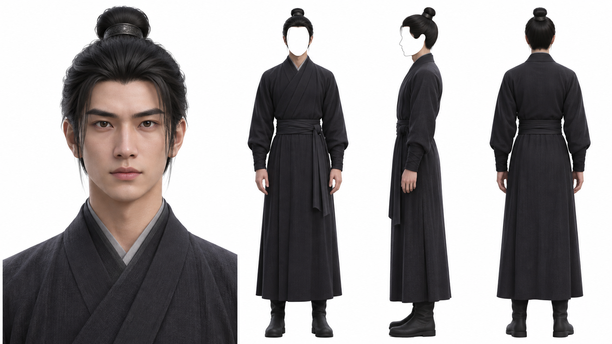

# 人物交付形式参考



本图是用户指定的人物资产交付形式参考，适用于 3D 与仿真人等已确认媒介。只参考四区排版、胸像与全身的展示关系、正／侧／背顺序，以及仅正侧脸遮白、背面无遮罩的安排。图中男性古装人物只是版式占位，不提供角色设定。

固定的是交付排版与逐区遮罩，画风由本次提示词决定；本图不把二维改成三维，也不把三维改成二维。提交时保留完整画风描述，不能让版式示例替代画风。右侧必须容纳正、侧、背三个独立全身，严格侧面是第三个区域，不能与正面或背面合并。

不参考图中五官、脸型、人物身份、年龄、性别、肤色、体型、发型、发饰、服装、气质或画风。人物外貌与衣装按本项目剧本、已确认设定或已采用身份母版处理，美术风格沿用当前项目；不能把参考图的人物换装后当作独立角色。

## 生成与交付提醒

> 只参考这张图的交付形式，不参考五官或人物形象；左侧正脸胸像，右侧正面、严格侧面、背面全身三视图，仅正侧脸遮白、背面无遮罩。人物身份、服装与画风以本项目已确认设定为准。

生成前查看本图的版式，再将布局写进本次提示词；上下文中已实际看过且版式未变时直接复用，不逐图重复读取或上传。默认不把这张图自动混入生图的身份或画风参考，也不登记成角色母版，不新增工具未支持的参考类型参数。本图像素尺寸不规定所有模型的输出尺寸，画幅与尺寸沿用本次已确认要求。

交付前实际查看候选原图，按[人物设定板版式](../SKILL.md#人物设定板版式)逐区对照；看过参考图、写对提示词或任务成功，都不能替代候选图的实际检查。缺视图、头脚裁切或遮罩边界不清楚时如实说明，沿用既有局部修复、费用与重试规则，不增加审批步骤或自动重生。

## 生成四区提示词

在本次加载返回的技能目录中执行：

```sh
python -B scripts/character_board_prompt.py --style-prompt "3D动漫，电影级三维CG，PBR材质、立体发束和柔和体积光照。" --character-prompt "成年女性，短卷发，绿色夹克和长裤，白色平底鞋。"
```

两个参数替换为本次完整画风和角色设定；示例不规定所有项目采用三维、女性或现代服装。助手只输出`prompt`与`image_aspect_ratio`，原样保留画风和人物描述，将A正脸胸像、B正面、C严格侧面、D背面的固定版式写进实际提示词。模型、渠道、价格、身份参考与幂等键仍按当前项目与实时目录确定，不把布局图上传成角色参考。这个命令只组装文本，不发起付费生成或自动审核。

当前候选仅缺侧面而其余区域可用时，给上述命令加`--edit-existing`，得到保留原人物、原画风并在正背之间补C侧面的编辑提示词。若使用`jubian_video image_generate`编辑，`parent_asset_id`指向这个已检查候选，`references`明确指向它的原图，不能使用版式示意图充当角色参考；不改已采用的正式资产。工具返回未核实就按原父资产与本次任务回读，核对新材质，不能把旧图当作修复结果。编辑后重新看四区与遮罩，仍失败则保留问题和已用费用，不自动反复提交。
